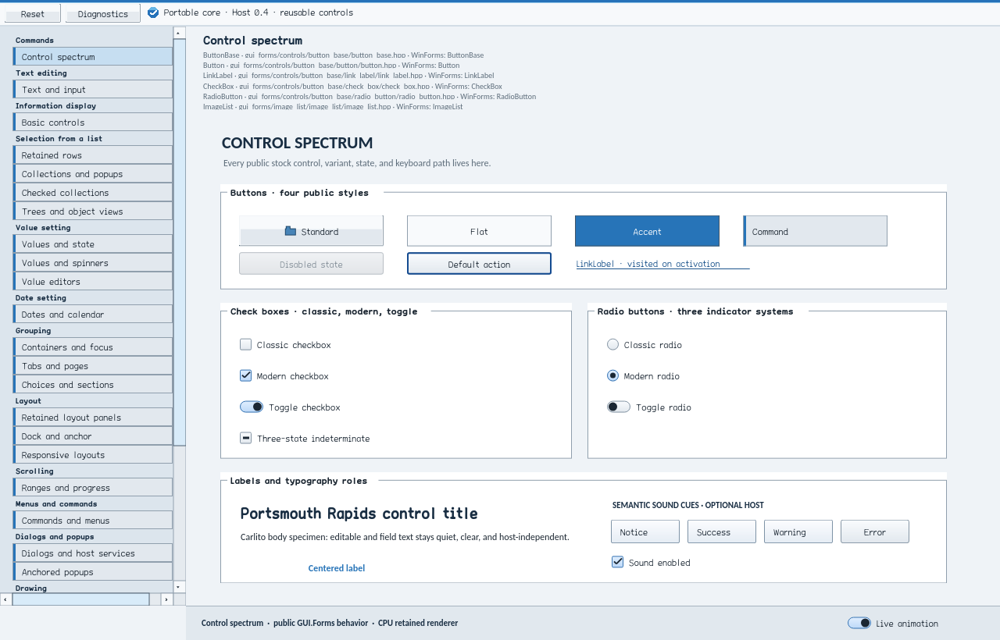
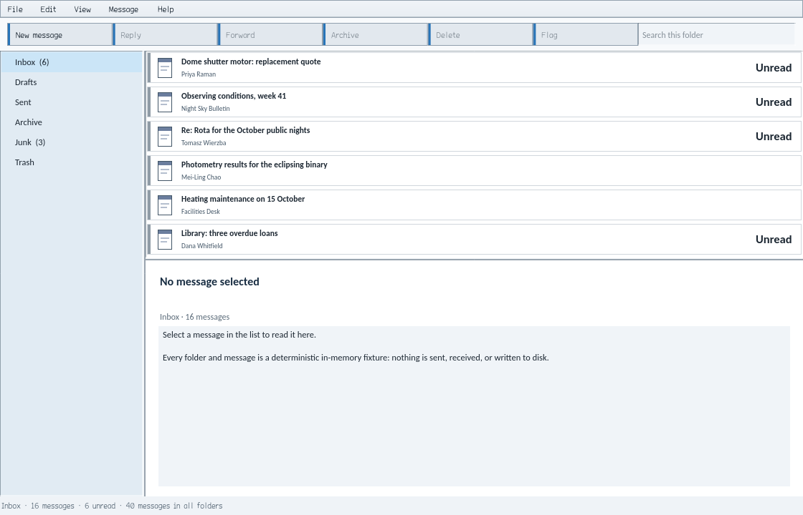

To the Holy One, blessed be He, from whom all good things come. We dedicate this work in gratitude for the nourishment that sustains human life, the energy that powers our tools, and the opportunity to weave information into works of use and beauty.

# GUI.Forms

A retained, WinForms-shaped native C++20 toolkit that paints on the CPU and
runs the same control tree on macOS, Windows and Linux.

[](https://github.com/falseywinchnet/gui_forms/actions/workflows/native.yml) [](https://gui-forms.readthedocs.io/) [](https://github.com/falseywinchnet/gui_forms/releases) [](LICENSE)  

**Status: early public preview. The API is not yet stable. The macOS and
Windows hosts are native; the Linux X11 host is opt-in. GUI.Forms is CPU-only
by design and has no GPU backend. Text is drawn by one HarfBuzz/FreeType
engine from bundled fonts, so the same string renders identically on every
platform ([ADR-004](decisions/ADR-004-one-text-rasterization-engine.md)).**

## First window

```cpp
#include <gui_forms/application.hpp>
#include <gui_forms/basic_controls.hpp>
#include <gui_forms/component.hpp>

#include <memory>

namespace gf = gui_forms;

struct Greeter final : gf::Component {
    std::shared_ptr<gf::Panel> root = gf::make_control<gf::Panel>(gf::StableId("root"));
    std::shared_ptr<gf::Label> status = gf::make_control<gf::Label>(gf::StableId("status"), "Ready.");
    std::shared_ptr<gf::Button> run = gf::make_control<gf::Button>(gf::StableId("run"), "Run");
    Greeter() {
        (*status).set_bounds({24.0, 24.0, 432.0, 32.0});
        (*run).set_bounds({24.0, 72.0, 120.0, 36.0});
        (*root).add_child(status);
        (*root).add_child(run);
        gf::on((*run).clicked(), *this, &Greeter::on_run); // owned: revoked with Greeter
    }
    void on_run() { (*status).set_text("Clicked."); }
};

int main() {
    Greeter greeter{};
    std::unique_ptr<gf::Window> window = std::make_unique<gf::Window>(greeter.root, gf::Size{480.0, 140.0});
    return gf::Application::run(std::move(window),
        {.title = "First window", .initial_size = {480.0, 140.0},
         .minimum_size = {320.0, 140.0}}).accepted() ? 0 : 1;
}
```

Controls are created once with a `StableId`, the tree owns them, mutation is
imperative, and painting uses accumulated damage bounds. The longer walkthrough is
in [Your first window](https://gui-forms.readthedocs.io/en/latest/user/first-window.html).





Both frames were written by the programs themselves with `--capture`, which
saves the first fully presented frame as a PNG and exits.

## Downloads

Three demonstration programs are built from `demo/` and
`file_manager_demoboard/` using only the public headers.

| Program | What it is |
|---|---|
| GUI.Forms Gallery | Catalogue of the stock controls on 29 pages grouped by function |
| GUI.Forms Explore (preview) | Fixture-backed file-explorer interface from `file_manager_demoboard/`; never touches the real filesystem |
| GUI.Forms Correspondence | Mail-client mockup over in-memory fixtures (`demo/correspondence/`); no real mail, filesystem or network |

Every push to `main` that passes the build, the tests and a launch of each
packaged program is published at
[releases/latest](https://github.com/falseywinchnet/gui_forms/releases/latest):
one archive and one installer per program for macOS arm64, Windows x64, Linux
x64 and Linux arm64, plus `SHA256SUMS.txt`. The `build-<sha>` pre-releases are
compiler-cache archives for CI, not downloads.

- **Linux** builds need an X11 display (XWayland works).
- **macOS** builds are ad hoc signed, not notarized. Right-click the app and
  choose Open on first launch.
- **Windows** builds are unsigned. SmartScreen shows "More info", then
  "Run anyway".

See [Download](https://gui-forms.readthedocs.io/en/latest/user/download.html) for the full platform notes.

## Features

- Retained controls with explicit ownership: the tree owns its children,
  handlers are owned by a `Component` and revoked with it.
- Typed layout, paint and hit-test dirtiness, with nested update scopes and
  bounded flushes.
- Damage-limited CPU painting. No redraw loop; nothing repaints until
  something changes.
- Forms-like focus, pointer, keyboard and activation behaviour on every host.
- One text engine (HarfBuzz shaping, FreeType rasterization, bundled fonts):
  identical glyphs on every OS.
- Structured instrumentation counters and snapshots, plus an on-screen
  diagnostics panel in the Gallery.
- Stable IDs on every control, used by logs, semantics, tests and automation.
- A C ABI seam (`include/gui_forms/c_api.h`) and an installed CMake SDK
  (`GUIForms::Application`).
- CNG (native resources) and PNG (interchange) are the only image codecs in
  the core.
- No GPU, no .NET, no browser engine.

## Controls

Every stock control, grouped by function; the table is generated from
[`manifests/controls.json`](manifests/controls.json).

<!-- controls:start -->
| Control | Function | Description |
|---|---|---|
| [`Button`](https://gui-forms.readthedocs.io/en/latest/api/generated/gui_forms.Button.html) | Commands | Push button with accept/cancel dialog results, default-button state, and four visual policies. |
| [`ButtonBase`](https://gui-forms.readthedocs.io/en/latest/api/generated/gui_forms.ButtonBase.html) |  | Shared retained command state machine for pointer, keyboard, mnemonic, semantic, and dialog activation that Button, CheckBox, RadioButton, and LinkLabel specialize. |
| [`CommandBar`](https://gui-forms.readthedocs.io/en/latest/api/generated/gui_forms.CommandBar.html) |  | Horizontal row of retained item buttons built from a replaceable CommandItem list that raises one group notification per replacement. |
| [`DropDownButton`](https://gui-forms.readthedocs.io/en/latest/api/generated/gui_forms.DropDownButton.html) |  | Command button with an explicit disclosure actuator that either routes the whole button to an owned popup menu or keeps a primary click region beside a trailing split region. |
| [`LinkLabel`](https://gui-forms.readthedocs.io/en/latest/api/generated/gui_forms.LinkLabel.html) |  | Command presented as underlined link text with retained visited state and link semantics. |
| [`MaskedTextBox`](https://gui-forms.readthedocs.io/en/latest/api/generated/gui_forms.MaskedTextBox.html) | Text editing | Text box that takes input through a mask (digits, letters, literals, case shifts, culture separators); refused input is reported with its position and reason. |
| [`TextBox`](https://gui-forms.readthedocs.io/en/latest/api/generated/gui_forms.TextBox.html) |  | Single- or multiline Unicode editor with directional selection, clipboard and history commands, password projection, bounded input length, suggest and append auto-complete, and ordered text/selection events. |
| [`TokenBox`](https://gui-forms.readthedocs.io/en/latest/api/generated/gui_forms.TokenBox.html) |  | Text entry whose accepted entries (Enter, a delimiter or an accepted completion) become removable tokens with stable identities, with keyboard selection and removal, a close glyph per token and suggestions from auto-complete. |
| [`Label`](https://gui-forms.readthedocs.io/en/latest/api/generated/gui_forms.Label.html) | Information display | Noninteractive text primitive with inherited typography roles, alignment, word wrapping, a bounded line count, and mnemonics. |
| [`PictureBox`](https://gui-forms.readthedocs.io/en/latest/api/generated/gui_forms.PictureBox.html) |  | Noninteractive image presenter over Window-owned generational image resources with the five PictureBoxSizeMode policies and bounded opacity. |
| [`ProgressBar`](https://gui-forms.readthedocs.io/en/latest/api/generated/gui_forms.ProgressBar.html) |  | Noninteractive range visualization with continuous, segmented, and marquee modes whose motion follows the Window frame scheduler and reduced-motion policy. |
| [`ReviewCard`](https://gui-forms.readthedocs.io/en/latest/api/generated/gui_forms.ReviewCard.html) |  | Typed review projection over Card that owns title, body, and verdict labels and projects pending/rejected state through ordinary Card laws. |
| [`BreadcrumbTrail`](https://gui-forms.readthedocs.io/en/latest/api/generated/gui_forms.BreadcrumbTrail.html) | Selection from a list | Location instrument whose logical path segments are virtual semantic children and whose exact-path TextBox occupies the row only while editing. |
| [`CheckedListBox`](https://gui-forms.readthedocs.io/en/latest/api/generated/gui_forms.CheckedListBox.html) |  | ListBox with an independently retained three-state check model, cancellable pre-change events, and optional check-on-click. |
| [`ChoiceGroup`](https://gui-forms.readthedocs.io/en/latest/api/generated/gui_forms.ChoiceGroup.html) |  | Row of retained item buttons that selects exactly one ChoiceItem and exposes the selection as a bindable Value. |
| [`ComboBox`](https://gui-forms.readthedocs.io/en/latest/api/generated/gui_forms.ComboBox.html) |  | Choice field, noneditable or with an editor (drop_down style), with placeholder projection, keyboard cycling, a transient ListBox popup, and auto-complete from its items or a custom list. |
| [`CorrespondenceView`](https://gui-forms.readthedocs.io/en/latest/api/generated/gui_forms.CorrespondenceView.html) |  | Variable-height virtual list with independent keyboard focus, delayed pointer inspection, and one persistent pinned item. |
| [`DataGridView`](https://gui-forms.readthedocs.io/en/latest/api/generated/gui_forms.DataGridView.html) |  | Grid of text, check box, combo box and button columns over unbound, virtual or BindingSource rows identified by stable row IDs, with cell or row selection kept by ID, in-place editing and only visible rows realized. |
| [`ListBox`](https://gui-forms.readthedocs.io/en/latest/api/generated/gui_forms.ListBox.html) |  | Virtual-row selector with single, multi-simple, and multi-extended selection policies, stable item identities, and scroll-window projection. |
| [`ListView`](https://gui-forms.readthedocs.io/en/latest/api/generated/gui_forms.ListView.html) |  | Item list with details, list, small-icon and large-icon views, check boxes, column headers that report clicks and resize, and a virtual mode that realizes only visible items. |
| [`ObjectView`](https://gui-forms.readthedocs.io/en/latest/api/generated/gui_forms.ObjectView.html) |  | Stable-ID virtual object collection with icon and details projections that owns no per-item controls. |
| [`TreeListView`](https://gui-forms.readthedocs.io/en/latest/api/generated/gui_forms.TreeListView.html) |  | Tree with tabular columns: nodes kept by stable ID, expand and collapse, sorting within siblings, resizable and movable columns, and only visible rows realized. |
| [`TreeView`](https://gui-forms.readthedocs.io/en/latest/api/generated/gui_forms.TreeView.html) |  | Flat-model retained tree that paints and publishes only visible rows while item identity and expansion state stay stable for unrealized descendants. |
| [`CheckBox`](https://gui-forms.readthedocs.io/en/latest/api/generated/gui_forms.CheckBox.html) | Value setting | Two- or three-state selection control with optional automatic cycling, three indicator families, and ordered state events. |
| [`ColorValueEditor`](https://gui-forms.readthedocs.io/en/latest/api/generated/gui_forms.ColorValueEditor.html) |  | Compound editor that delegates editing to a real TextBox and adds a checker-backed swatch with canonical #RRGGBBAA conversion. |
| [`DomainUpDown`](https://gui-forms.readthedocs.io/en/latest/api/generated/gui_forms.DomainUpDown.html) |  | Text field with up and down arrows stepping through an ordered string list; the selection follows the text, with optional wrapping, sorting and a read-only field. |
| [`FlagsValueEditor`](https://gui-forms.readthedocs.io/en/latest/api/generated/gui_forms.FlagsValueEditor.html) |  | Compact editor for independent-bit enumeration values that opens a real CheckedListBox popup under Window popup and focus-scope leases. |
| [`InstrumentRack`](https://gui-forms.readthedocs.io/en/latest/api/generated/gui_forms.InstrumentRack.html) |  | Bounded retained rack of compact editing modules that reconciles stable module and field identities across model replacement. |
| [`NumericUpDown`](https://gui-forms.readthedocs.io/en/latest/api/generated/gui_forms.NumericUpDown.html) |  | Composite numeric editor over an owned TextBox and source-private spin buttons with ordered ranges, bounded step and precision, and decimal or hexadecimal formatting. |
| [`PropertyGrid`](https://gui-forms.readthedocs.io/en/latest/api/generated/gui_forms.PropertyGrid.html) |  | Metadata-driven inspector and editor over one or more selected Controls that projects descriptors into a PropertyList. |
| [`PropertyList`](https://gui-forms.readthedocs.io/en/latest/api/generated/gui_forms.PropertyList.html) |  | Settings surface over caller-authored stable groups and rows that owns stock or replacement child editors, reset buttons, and one vertical scroll plane. |
| [`RadioButton`](https://gui-forms.readthedocs.io/en/latest/api/generated/gui_forms.RadioButton.html) |  | Retained checked state with container-scoped named exclusion groups, optional automatic checking, and radio semantics. |
| [`RangeControl`](https://gui-forms.readthedocs.io/en/latest/api/generated/gui_forms.RangeControl.html) |  | Nonvisual retained authority for ordered bounds, a constrained value, small/large changes, and orientation that TrackBar, ProgressBar, and ScrollBar specialize. |
| [`TrackBar`](https://gui-forms.readthedocs.io/en/latest/api/generated/gui_forms.TrackBar.html) |  | Slider over RangeControl with bounded tick frequency, absolute pointer positioning, keyboard movement, and slider semantics. |
| [`DateTimePicker`](https://gui-forms.readthedocs.io/en/latest/api/generated/gui_forms.DateTimePicker.html) | Date setting | Civil date/time field with validated bounds, four formatting policies, optional check state, and calendar or spin presentation. |
| [`MonthCalendar`](https://gui-forms.readthedocs.io/en/latest/api/generated/gui_forms.MonthCalendar.html) |  | One or more month pages for selecting a date or a run of dates, with a date range, today marker, bold dates, week numbers and keyboard navigation. |
| [`Card`](https://gui-forms.readthedocs.io/en/latest/api/generated/gui_forms.Card.html) | Grouping | Header/body/footer composition that owns each installed section as an ordinary visual child and returns the detached predecessor on replacement. |
| [`ContainerControl`](https://gui-forms.readthedocs.io/en/latest/api/generated/gui_forms.ContainerControl.html) |  | ScrollableControl with descendant-scoped active-control authority and inherited validation policy. |
| [`ExpandableSections`](https://gui-forms.readthedocs.io/en/latest/api/generated/gui_forms.ExpandableSections.html) |  | Stack of captioned sections whose content controls expand and collapse individually or in single-open mode. |
| [`GroupBox`](https://gui-forms.readthedocs.io/en/latest/api/generated/gui_forms.GroupBox.html) |  | Titled Panel with mnemonic focus routing, caption-aware border painting, and group semantics. |
| [`MaterialPanel`](https://gui-forms.readthedocs.io/en/latest/api/generated/gui_forms.MaterialPanel.html) |  | Content-agnostic container painted with a SurfaceMaterial. |
| [`NavigationPane`](https://gui-forms.readthedocs.io/en/latest/api/generated/gui_forms.NavigationPane.html) |  | Outlook-style navigation pane over its own PageSet: header with collapse, the selected page's control, a grip stepping the large buttons, an overflow icon strip with a configure menu (more, fewer, hidden pages, options event), a collapsed bar with a turned caption opening the content in a popup, and a state record the program saves. |
| [`PageStrip`](https://gui-forms.readthedocs.io/en/latest/api/generated/gui_forms.PageStrip.html) |  | The tab headers of a borrowed PageSet in one row on any edge (turned labels on the sides): content-sized, fixed or fill tabs with minimum and maximum widths, scroll and list buttons or shrink then a counted list when they overflow, close buttons with frozen widths, modified dots, icon-only pinned tabs, live drag reorder with a claimable drag start, automatic or manual keyboard selection, mnemonics, and tab-list semantics without press. |
| [`PageView`](https://gui-forms.readthedocs.io/en/latest/api/generated/gui_forms.PageView.html) |  | A PageStrip over the view's own PageSet with the selected page's control below it, in the strip or document preset: per-page focus memory, late content requested on first selection, close requests decided by the owner with Ctrl+F4 and middle click, Ctrl+PageDown and a Ctrl+Tab policy for nesting and docking, optional F6 region, and tab panels linked from their tabs. |
| [`Panel`](https://gui-forms.readthedocs.io/en/latest/api/generated/gui_forms.Panel.html) |  | Scroll-capable surface primitive with theme-role rendering, explicit background and border overrides, and optional named-group semantics. |
| [`ScaledGroupBox`](https://gui-forms.readthedocs.io/en/latest/api/generated/gui_forms.ScaledGroupBox.html) |  | GroupBox whose children occupy stable design-space slots arranged proportionally to the current content bounds. |
| [`TabControl`](https://gui-forms.readthedocs.io/en/latest/api/generated/gui_forms.TabControl.html) |  | Owner of TabPage lifetime and selection with per-page focus restoration, tabs on an internal PageStrip (caption-sized, fill or fixed by size mode, scroll and list buttons when they overflow), four header alignments, three appearances, tab images from an ImageList by key or index, and virtual tab semantics. |
| [`TabPage`](https://gui-forms.readthedocs.io/en/latest/api/generated/gui_forms.TabPage.html) |  | Panel surface owned by a TabControl with bounded caption text and page semantics. |
| [`UserControl`](https://gui-forms.readthedocs.io/en/latest/api/generated/gui_forms.UserControl.html) |  | Authored-container base that distinguishes current attachment from first committed load and counts attachment epochs. |
| [`CommandOverflowPanel`](https://gui-forms.readthedocs.io/en/latest/api/generated/gui_forms.CommandOverflowPanel.html) | Layout | Horizontal command-group container that owns only layout collapse and the overflow actuator's availability while command authority stays with the consumer. |
| [`DockNavigator`](https://gui-forms.readthedocs.io/en/latest/api/generated/gui_forms.DockNavigator.html) |  | The two-list Ctrl+Tab switcher of docking: active tool windows beside active files in most-recently-active order, stepping with Tab and the arrows and choosing on the modifier's release, Enter or a press. |
| [`DockSite`](https://gui-forms.readthedocs.io/en/latest/api/generated/gui_forms.DockSite.html) |  | The docked part of a DockWorkspace in one window: binary splits with 3-unit seams moved by pointer and keyboard within minimums, captioned tool stacks and the document area built from PageView, root-level pins that auto-hide a stack to side tabs on the window's edges with sliding in-window flyouts, the position menu, F6 regions, the Ctrl+Tab navigator, Escape and Shift+Escape, a maximized document area, tool stacks collapsing by priority behind side tabs when the window is too small, and dragging in one window: caption and tab drags with a postage-stamp miniature, position-sensitive targets with quiet tiles over the hovered pane and global edge targets, Ctrl suppression, snap-back, and the keyboard move mode. |
| [`FlowLayoutPanel`](https://gui-forms.readthedocs.io/en/latest/api/generated/gui_forms.FlowLayoutPanel.html) |  | Directional packing container with four flow directions, optional wrapping, bounded spacing, per-child margins, and stable flow breaks. |
| [`MasterDetailView`](https://gui-forms.readthedocs.io/en/latest/api/generated/gui_forms.MasterDetailView.html) |  | Content-agnostic master/detail shell with responsive presentation, a draggable and keyboard-operable splitter, and focus transfer on collapse. |
| [`ResponsiveTrackPanel`](https://gui-forms.readthedocs.io/en/latest/api/generated/gui_forms.ResponsiveTrackPanel.html) |  | Track-based container that places each child in one authored track and collapses tracks as an effective-layout state without changing author visibility. |
| [`ScaledPanel`](https://gui-forms.readthedocs.io/en/latest/api/generated/gui_forms.ScaledPanel.html) |  | Panel that maps caller-authored design-space child rectangles into the current content bounds while retaining slot identity independently of child order. |
| [`SplitContainer`](https://gui-forms.readthedocs.io/en/latest/api/generated/gui_forms.SplitContainer.html) |  | Two-pane allocation container with bounded splitter distance, fixed-pane resize preservation, pointer and keyboard seam input, and collapse. |
| [`Splitter`](https://gui-forms.readthedocs.io/en/latest/api/generated/gui_forms.Splitter.html) |  | Windows Forms migration facade: a bar docked after a docked sibling that resizes it by dragging, within MinSize and MinExtra, over the dock layout; new code uses SplitContainer. |
| [`SplitterPanel`](https://gui-forms.readthedocs.io/en/latest/api/generated/gui_forms.SplitterPanel.html) |  | Allocated pane surface owned by SplitContainer that paints its own background from committed bounds. |
| [`TableLayoutPanel`](https://gui-forms.readthedocs.io/en/latest/api/generated/gui_forms.TableLayoutPanel.html) |  | Grid container with bounded rows and columns, absolute/percent/auto tracks, explicit or automatic placement, and row/column spans. |
| [`HScrollBar`](https://gui-forms.readthedocs.io/en/latest/api/generated/gui_forms.HScrollBar.html) | Scrolling | Explicit horizontal ScrollBar leaf type. |
| [`ScrollableControl`](https://gui-forms.readthedocs.io/en/latest/api/generated/gui_forms.ScrollableControl.html) |  | Retained scrolling state machine with overflow discovery, viewport rectangles, two axis policies, wheel/track/thumb interaction, and virtual scrollbar semantics. |
| [`ScrollBar`](https://gui-forms.readthedocs.io/en/latest/api/generated/gui_forms.ScrollBar.html) |  | RangeControl with bounded button and thumb geometry, proportional thumb allocation, drag and track interaction, and retained auto-repeat. |
| [`VScrollBar`](https://gui-forms.readthedocs.io/en/latest/api/generated/gui_forms.VScrollBar.html) |  | Explicit vertical ScrollBar leaf type. |
| [`BackstageView`](https://gui-forms.readthedocs.io/en/latest/api/generated/gui_forms.BackstageView.html) | Menus and commands | The File tab's full page: a column of fast commands and topics beside the selected topic's page, opened by a Ribbon over everything below its tab row. |
| [`BindingNavigator`](https://gui-forms.readthedocs.io/en/latest/api/generated/gui_forms.BindingNavigator.html) |  | ToolStrip that moves through a BindingSource with first, previous, position, count, next, last, add and delete, each a shared Command enabled by the source's position, count and permissions. |
| [`ColorCommand`](https://gui-forms.readthedocs.io/en/latest/api/generated/gui_forms.ColorCommand.html) |  | Value command of a colour picker: shares identity and state with a Command and carries a colour, or Automatic, and the recent colours. |
| [`Command`](https://gui-forms.readthedocs.io/en/latest/api/generated/gui_forms.Command.html) |  | Shared retained authority for menu, shortcut, context, semantic, and test surfaces with validated UTF-8 state and enabled-only invocation. |
| [`ContextMenu`](https://gui-forms.readthedocs.io/en/latest/api/generated/gui_forms.ContextMenu.html) |  | Popup-menu controller whose rows are temporary popup presentations over stable MenuItemSpec identities and bound Commands. |
| [`FontCommand`](https://gui-forms.readthedocs.io/en/latest/api/generated/gui_forms.FontCommand.html) |  | Value command of a font control: shares identity and state with a Command and carries a font family and size. |
| [`GalleryCommand`](https://gui-forms.readthedocs.io/en/latest/api/generated/gui_forms.GalleryCommand.html) |  | Value command of a gallery: shares identity and state with a Command, carries the chosen item, and raises preview and cancel-preview events. |
| [`MenuStrip`](https://gui-forms.readthedocs.io/en/latest/api/generated/gui_forms.MenuStrip.html) |  | Top-level application menu bar whose active menu is presented by ContextMenu as a separate popup root bound to shared Command instances. |
| [`QuickAccessToolbar`](https://gui-forms.readthedocs.io/en/latest/api/generated/gui_forms.QuickAccessToolbar.html) |  | Ribbon Quick Access Toolbar: a ToolStrip of flat command buttons with a customize menu that shows or hides each declared command and records the toolbar's placement above or below the ribbon. |
| [`Ribbon`](https://gui-forms.readthedocs.io/en/latest/api/generated/gui_forms.Ribbon.html) |  | Office 2010-style ribbon: File tab and core tabs over a command plane of captioned groups with dialog launchers and command records bound to shared Commands, hosted editors and galleries, adaptive scaling by group layouts and a reduction order (collapsed groups open in a popup, scrolling below the narrowest layout), the document-area hide rule, contextual tab sets tinted from the accent ramp with built-in selection rules, application modes, and minimizing by a click on the selected tab. |
| [`RibbonColorPicker`](https://gui-forms.readthedocs.io/en/latest/api/generated/gui_forms.RibbonColorPicker.html) |  | Ribbon drop-down colour picker: a split button that applies its colour, and a palette popup of Automatic, palette and recent colours, through a ColorCommand. |
| [`RibbonFontControl`](https://gui-forms.readthedocs.io/en/latest/api/generated/gui_forms.RibbonFontControl.html) |  | Ribbon font control: a family list and a size list choosing one font through a FontCommand, hosted in a Ribbon or standalone. |
| [`RibbonGallery`](https://gui-forms.readthedocs.io/en/latest/api/generated/gui_forms.RibbonGallery.html) |  | Ribbon gallery of image items in categories, in the ribbon with scroll and more buttons or as a drop-down popup, with live preview through a GalleryCommand and only visible rows realized. |
| [`StatusStrip`](https://gui-forms.readthedocs.io/en/latest/api/generated/gui_forms.StatusStrip.html) |  | Status bar laid out as a ToolStrip that never overflows, with spring labels sharing the free width and a sizing grip. |
| [`ToolStrip`](https://gui-forms.readthedocs.io/en/latest/api/generated/gui_forms.ToolStrip.html) |  | Command strip of buttons, labels, separators, drop-down and split buttons laid out as an item system, with an overflow menu for items that do not fit. |
| [`ToolStripContainer`](https://gui-forms.readthedocs.io/en/latest/api/generated/gui_forms.ToolStripContainer.html) |  | Four ToolStripPanels around a content panel; the edge panels take the room their strips need and the content takes the rest. |
| [`ToolStripPanel`](https://gui-forms.readthedocs.io/en/latest/api/generated/gui_forms.ToolStripPanel.html) |  | Band along one edge that stacks joined ToolStrips in rows (top, bottom) or vertical columns (left, right), as thick as its strips. |
| [`AnchoredPopupLayer`](https://gui-forms.readthedocs.io/en/latest/api/generated/gui_forms.AnchoredPopupLayer.html) | Dialogs and popups | Full-client overlay that owns one retained popup content subtree, re-resolves anchored bounds on resize, and reports click-away and Escape requests. |
| [`FontDialog`](https://gui-forms.readthedocs.io/en/latest/api/generated/gui_forms.FontDialog.html) |  | In-window owned dialog choosing a bundled face by role, a style the face has, and a size, with a preview and Apply, OK and Cancel; returns a FontSpec. |
| [`RibbonToolTip`](https://gui-forms.readthedocs.io/en/latest/api/generated/gui_forms.RibbonToolTip.html) |  | Nonvisual provider of enhanced tooltips on controls and ToolStrip items: title, description, shortcut, image, a disabled command's reason, and an F1 help topic reported as an event. |
| [`TaskDialog`](https://gui-forms.readthedocs.io/en/latest/api/generated/gui_forms.TaskDialog.html) |  | In-window owned message dialog of TaskDialogPage pages: heading, text, icon, standard and custom buttons, radio buttons, a verification check box, an expander, a footnote and a progress bar, with navigation between pages. |
| [`ThreadExceptionDialog`](https://gui-forms.readthedocs.io/en/latest/api/generated/gui_forms.ThreadExceptionDialog.html) |  | The dialog for an exception the application did not handle: a TaskDialog preset with the error icon, the message, details behind an expander, and Continue and Quit, returned as cancel and abort. |
| [`ToolTip`](https://gui-forms.readthedocs.io/en/latest/api/generated/gui_forms.ToolTip.html) |  | Nonvisual provider that maps Controls to tooltip text and presents a retained, input-transparent overlay owned by each target. |
| [`DrawingSurface`](https://gui-forms.readthedocs.io/en/latest/api/generated/gui_forms.DrawingSurface.html) | Drawing | Owner-render surface configured through the renderer-neutral Painter vocabulary without a Control subclass. |
| [`LiveSurface`](https://gui-forms.readthedocs.io/en/latest/api/generated/gui_forms.LiveSurface.html) |  | Latest-frame surface where a producer publishes complete frame candidates and painters acquire only the newest immutable one. |
| [`RasterCanvas`](https://gui-forms.readthedocs.io/en/latest/api/generated/gui_forms.RasterCanvas.html) |  | Viewport over an owned GUI.Drawing bitmap that handles presentation, coordinate transforms, resource synchronization, and local invalidation. |
| [`EasingPreview`](https://gui-forms.readthedocs.io/en/latest/api/generated/gui_forms.EasingPreview.html) | Diagnostics | Animation and easing conformance surface over an owned AnimationTimeline with configurable tracks and motion policy. |
| [`MetricsView`](https://gui-forms.readthedocs.io/en/latest/api/generated/gui_forms.MetricsView.html) |  | View over the structured Window metrics snapshot. |
| [`TypographySpecimen`](https://gui-forms.readthedocs.io/en/latest/api/generated/gui_forms.TypographySpecimen.html) |  | Typography review control that draws one committed text run with its logical line box, resolved baseline, and provider status. |
| [`VisualInspectorOverlay`](https://gui-forms.readthedocs.io/en/latest/api/generated/gui_forms.VisualInspectorOverlay.html) |  | Transparent companion overlay that draws a target's arranged, visual, and effective clipped bounds without altering hit testing. |
| [`VisualInspectorView`](https://gui-forms.readthedocs.io/en/latest/api/generated/gui_forms.VisualInspectorView.html) |  | Presentation of the Window visual-inspection snapshot for demoboards and local diagnostics. |
| [`BackgroundWorker`](https://gui-forms.readthedocs.io/en/latest/api/generated/gui_forms.BackgroundWorker.html) | Components | Runs one work function at a time on a gui_forms Worker thread and delivers progress and completion on its window's UI thread through the dispatcher, with cooperative cancellation. |
| [`Binding`](https://gui-forms.readthedocs.io/en/latest/api/generated/gui_forms.Binding.html) |  | Connects one Control property to one BindingSource field with validated conversion, update timing, and error routing. |
| [`BindingContext`](https://gui-forms.readthedocs.io/en/latest/api/generated/gui_forms.BindingContext.html) |  | Window-scoped weak membership and disposal subscriptions for BindingSources. |
| [`BindingSource`](https://gui-forms.readthedocs.io/en/latest/api/generated/gui_forms.BindingSource.html) |  | Owns stable rows, currency, edit snapshots, list and error events, and the active Bindings for one Window. |
| [`DockWorkspace`](https://gui-forms.readthedocs.io/en/latest/api/generated/gui_forms.DockWorkspace.html) |  | Docking workspace component: owns the DockLayout, the panel registrations with lazy factories and their content, and the active panel and active document tracks with their histories, named on the window's command routing chain. |
| [`ErrorProvider`](https://gui-forms.readthedocs.io/en/latest/api/generated/gui_forms.ErrorProvider.html) |  | Validation adornment provider that projects error text onto the target semantic node and gives each visible target an independent overlay glyph. |
| [`HelpProvider`](https://gui-forms.readthedocs.io/en/latest/api/generated/gui_forms.HelpProvider.html) |  | Policy-free help provider that retains authored metadata and routes F1 and pointer help requests to the consumer. |
| [`ImageList`](https://gui-forms.readthedocs.io/en/latest/api/generated/gui_forms.ImageList.html) |  | Ordered, keyed collection of PNG-sourced Window image resources with density and state variants and atomic mutation. |
| [`NotifyIcon`](https://gui-forms.readthedocs.io/en/latest/api/generated/gui_forms.NotifyIcon.html) |  | Icon in the desktop's notification area (Windows tray, macOS status item, X11 system tray) with a tooltip, clicks, a native context menu and notification text, each refused explicitly where the host lacks the capability. |
| [`SemanticFeedback`](https://gui-forms.readthedocs.io/en/latest/api/generated/gui_forms.SemanticFeedback.html) |  | Turns one-shot application transitions into bounded, traceable host cues. |
| [`Timer`](https://gui-forms.readthedocs.io/en/latest/api/generated/gui_forms.Timer.html) |  | Timer whose callbacks are serialized with input, layout, and paint on the owning Window's UI thread and whose late ticks are coalesced. |
<!-- controls:end -->

## Supported platforms

| Platform | Host | Status | Notes |
|---|---|---|---|
| macOS 14.0+ | AppKit | Native | Apple silicon (arm64) only; builds `GUI.Forms Gallery.app` |
| Windows 10+ | Win32 DIB | Native | x64; native build in MSYS2 CLANG64 with LLVM 22.1.x |
| Linux | X11 | Opt-in | `-DGUI_FORMS_ENABLE_LINUX_HOST=ON`; Ubuntu 24.04 x64 and arm64 tested in CI; programs packaged as `.deb` and `.tar.gz` |

The portable core (`Core`, `Controls`, `Drawing`, `Threading`) is host
independent; its build still requires LLVM 22.1.x. The `Application` host is
platform specific.

## Build from source

Prerequisites: CMake 3.25+, Ninja, LLVM 22.1 (selected by
[`cmake/llvm22.cmake`](cmake/llvm22.cmake)) and Python 3.12+. Native builds
require an explicit `sh third_party/fetch_text_stack.sh` before configuration.
Follow [Install](https://gui-forms.readthedocs.io/en/latest/user/install.html) for the platform-specific renderer,
host and dependency preparation. CI reuses tested trees and publishes a
compiler cache per platform; see
[Fast, reproducible builds](https://gui-forms.readthedocs.io/en/latest/building/fast-builds.html).

A renderer-free build for core and control tests needs no Skia or text fetch:

```sh
cmake -S . -B build -G Ninja -DCMAKE_BUILD_TYPE=Release \
    -DCMAKE_TOOLCHAIN_FILE=cmake/llvm22.cmake \
    -DGUI_FORMS_ENABLE_SKIA=OFF -DGUI_FORMS_ENABLE_HARFBUZZ_TEXT=OFF \
    -DGUI_FORMS_ENABLE_MACOS_HOST=OFF -DGUI_FORMS_ENABLE_WINDOWS_HOST=OFF \
    -DGUI_FORMS_ENABLE_LINUX_HOST=OFF -DGUI_FORMS_BUILD_GALLERY=OFF
cmake --build build --parallel
ctest --test-dir build --output-on-failure
```

After configuring a native build as described in Install, run the Gallery:

- macOS: `open "build/GUI.Forms Gallery.app"`
- Windows: `build/GUI.Forms Gallery.exe` (keep `fonts/` beside it)
- Linux: `build/gui-forms-gallery`; configure with
  `-DGUI_FORMS_ENABLE_LINUX_HOST=ON`

Per-platform toolchain setup and every build option are in
[Build from source](https://gui-forms.readthedocs.io/en/latest/building/index.html).

## Consume the SDK

```cmake
cmake_minimum_required(VERSION 3.25)
project(MyForms LANGUAGES CXX)
find_package(GUIForms 0.2 CONFIG REQUIRED COMPONENTS Application)
add_executable(app main.cpp)
target_compile_features(app PRIVATE cxx_std_20)
target_link_libraries(app PRIVATE GUIForms::Application)
```

Install with `cmake --install build`, then configure your project with
`-DCMAKE_PREFIX_PATH=<prefix>` and the same toolchain file. Never link
`GUIForms::Core` or `GUIForms::Controls` into a program that links
`GUIForms::Application`; CMake rejects the combination. Details and runtime
files to ship: [Consume the SDK](https://gui-forms.readthedocs.io/en/latest/user/consume-the-sdk.html).
`examples/reference/` is a complete consumer built against the installed SDK
in CI.

## Documentation

- [gui-forms.readthedocs.io](https://gui-forms.readthedocs.io/): the rendered
  site, built from [`docs/`](docs/).
- [Controls by function](https://gui-forms.readthedocs.io/en/latest/controls/generated/by-function.html): every stock
  control, its WinForms counterpart and a one-line description.
- [API reference](https://gui-forms.readthedocs.io/en/latest/api/index.html): every public type, member and
  enumeration, generated from the headers.
- [`decisions/`](decisions/): architecture decision records.
- [`planning/`](planning/): internal plans and working notes, kept as records
  rather than user documentation.

## Project boundaries

GUI.Forms is a control toolkit. Deliberately excluded: GPU rendering (no Ganesh, Graphite, GL,
Vulkan, Metal, Direct3D or WebGPU), .NET, Java, browser engines, Godot,
immediate-mode control APIs, host font catalogues for control text, and image codecs other than
PNG. AppKit stays in `src/host/macos/`, Win32 in `src/host/windows/`, X11 in
`src/host/linux/` and Skia in `src/render/skia/`; tests enforce these
boundaries.

## Contributing

CI ([`native.yml`](.github/workflows/native.yml)) must pass on every platform.
C++ follows [`planning/PROGRAMMING_HOUSE_STYLE.md`](planning/PROGRAMMING_HOUSE_STYLE.md);
CI fails on any spelling finding from
`python3 -B tools/check_house_style.py include src demo tests examples tools file_manager_demoboard stx_vorbis`,
so run it before you push. Build the docs with `sphinx-build -W docs <out>` so
warnings fail.
Boundary violations fail `ctest` before review.

## License

[MIT](LICENSE). Bundled fonts carry their own notices in
[`assets/fonts/ATTRIBUTION.md`](assets/fonts/ATTRIBUTION.md): Portsmouth
Rapids and the rest of the Portsmouth family (MIT, the owner's typefaces),
Carlito, Cousine and the Noto fallback faces (SIL OFL 1.1).
