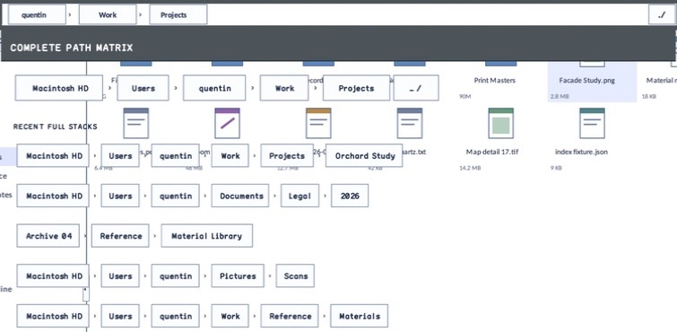

% Generated by tools/generate_library_docs.py from the checked-in headers and docs/library/manual.json. Do not edit by hand.

# AnchoredPopupPlacement

- Status: **OBSERVED: bundle 005 value-policy split; M4 build, focused tests, and Screen Sharing pass**
- Kind: **struct**
- Scope: public header
- Source layout: header-only or distributed
- Hierarchy: `AnchoredPopupPlacement`
- Declaration: `include/gui_forms/controls/panel/anchored_popup_layer/anchored_popup_placement/anchored_popup_placement.hpp:21`
- Definition: `inline/header-only`
- Type narrative: hand-reviewed
- Method narratives: no declared methods

AnchoredPopupPlacement is the caller-authored geometry policy for preferred size, horizontal alignment, preferred vertical side, gap, viewport margin, and optional vertical flipping. It contains no transient ownership or rendering state.

## Visual evidence

M4 File Manager Demoboard crop showing the resolved path-matrix popup below and far-aligned to its path anchor.

## Declared methods

No methods were discovered in this declaration.
