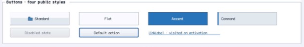

% Generated by tools/generate_library_docs.py from the checked-in headers and docs/library/manual.json. Do not edit by hand.

# ButtonBase

- Status: **OBSERVED: bundle 002 split; M4 build, focused tests, and Screen Sharing pass**
- Kind: **class / visual retained control**
- Scope: public header
- Source layout: isolated per type
- Hierarchy: `Control → ButtonBase`
- Declaration: `include/gui_forms/controls/button_base/button_base.hpp:45`
- Definition: `src/controls/button_base/button_base.cpp`
- Type narrative: hand-reviewed
- Method narratives: 47 hand-reviewed, 29 declaration-derived

ButtonBase is the authoritative retained command state machine for pointer, keyboard, mnemonic, semantic, and dialog activation, with theme/compatibility rendering, image-list resolution, content alignment, explicit padding, disclosure state, and lifetime-safe events.

## Visual evidence



M4 Complete Showcase crop showing inherited button content, states, focus/default cues, and LinkLabel specialization.

## Declared methods

### `ButtonBase` (public)

```cpp
explicit ButtonBase(StableId stable_id, std::string text =
```

Constructs a focusable hand-cursor command and registers reflected text, font, image, and content-padding properties.

### `~ButtonBase` (public)

```cpp
~ButtonBase() override
```

Constructs or tears down the retained ButtonBase object according to its ownership contract. *(declaration-derived)*

### `bind` (public)

```cpp
virtual void bind(Command& command)
```

Executes ButtonBase's bind operation against retained state; the signature records its exact inputs, result, constness, and failure surface. *(declaration-derived)*

### `unbind_command` (public)

```cpp
void unbind_command() noexcept
```

Executes ButtonBase's unbind command operation against retained state; the signature records its exact inputs, result, constness, and failure surface. *(declaration-derived)*

### `command_connected` (public)

```cpp
[[nodiscard]] bool command_connected() const noexcept
```

Reports the current command connected value without mutation. *(declaration-derived)*

### `text` (public)

```cpp
[[nodiscard]] const std::string& text() const noexcept
```

Returns authored button text including mnemonic markers.

### `set_text` (public)

```cpp
virtual void set_text(std::string text)
```

Commits text and invalidates measure, paint, and semantics before publishing text_changed.

### `font` (public)

```cpp
[[nodiscard]] FontSpec font() const noexcept
```

Returns the explicit button content font.

### `set_font` (public)

```cpp
void set_font(FontSpec font)
```

Validates and commits the FontSpec for content measurement and painting.

### `text_line_spacing` (public)

```cpp
[[nodiscard]] double text_line_spacing() const noexcept
```

Reports the current text line spacing value without mutation. *(declaration-derived)*

### `set_text_line_spacing` (public)

```cpp
void set_text_line_spacing(double spacing)
```

Synchronously updates the retained text line spacing property. Validation, typed invalidation, and notifications are defined by the implementation. *(declaration-derived)*

### `style` (public)

```cpp
[[nodiscard]] const BasicControlStyle& style() const noexcept
```

Returns the explicit compatibility style or active Theme basic style.

### `has_style_override` (public)

```cpp
[[nodiscard]] bool has_style_override() const noexcept
```

Reports whether compatibility frame/text painting is authoritative.

### `set_style` (public)

```cpp
void set_style(BasicControlStyle style)
```

Installs an explicit BasicControlStyle and invalidates visual/semantic state.

### `clear_style` (public)

```cpp
void clear_style()
```

Removes compatibility colors and resumes role-recipe rendering.

### `visual_recipes_override` (public)

```cpp
[[nodiscard]] const std::optional<ControlStateRecipes>& visual_recipes_override() const noexcept
```

Reports the current visual recipes override value without mutation. *(declaration-derived)*

### `set_visual_recipes` (public)

```cpp
void set_visual_recipes(ControlStateRecipes recipes)
```

Synchronously updates the retained visual recipes property. Validation, typed invalidation, and notifications are defined by the implementation. *(declaration-derived)*

### `clear_visual_recipes` (public)

```cpp
void clear_visual_recipes()
```

Removes the explicit visual recipes value and restores fallback behavior. *(declaration-derived)*

### `connection_topology` (public)

```cpp
[[nodiscard]] const std::optional<ConnectedControlTopology>& connection_topology() const noexcept
```

Reports the current connection topology value without mutation. *(declaration-derived)*

### `set_connection_topology` (public)

```cpp
void set_connection_topology( std::optional<ConnectedControlTopology> topology)
```

Synchronously updates the retained connection topology property. Validation, typed invalidation, and notifications are defined by the implementation. *(declaration-derived)*

### `image` (public)

```cpp
[[nodiscard]] ImageId image() const noexcept
```

Returns the direct generational ImageId, if direct-image selection is active.

### `set_image` (public)

```cpp
void set_image(ImageId image)
```

Validates Window ownership, selects direct image mode, and clears key/index selection atomically.

### `clear_image` (public)

```cpp
void clear_image()
```

Clears direct/key/index image selection through the common image mutation law.

### `image_list` (public)

```cpp
[[nodiscard]] std::shared_ptr<ImageList> image_list() const noexcept
```

Returns the retained ImageList owner used for state/density resolution.

### `set_image_list` (public)

```cpp
void set_image_list(std::shared_ptr<ImageList> image_list)
```

Validates liveness, Window ownership, and current index before reconnecting change observation.

### `image_index` (public)

```cpp
[[nodiscard]] int image_index() const noexcept
```

Returns the selected ImageList index or -1 when index selection is inactive.

### `set_image_index` (public)

```cpp
void set_image_index(int image_index)
```

Validates range, selects index mode, and clears direct/key selection atomically.

### `image_key` (public)

```cpp
[[nodiscard]] const std::string& image_key() const noexcept
```

Returns the UTF-8 ImageList key used by key selection mode.

### `set_image_key` (public)

```cpp
void set_image_key(std::string image_key)
```

Validates UTF-8 and length, selects key mode, and clears direct/index selection.

### `image_alignment` (public)

```cpp
[[nodiscard]] ContentAlignment image_alignment() const noexcept
```

Returns independent image alignment used for overlay content.

### `set_image_alignment` (public)

```cpp
void set_image_alignment(ContentAlignment alignment)
```

Validates the nine-position vocabulary and commits paint/semantic alignment.

### `text_alignment` (public)

```cpp
[[nodiscard]] ContentAlignment text_alignment() const noexcept
```

Returns text or combined-group alignment within padded content bounds.

### `set_text_alignment` (public)

```cpp
void set_text_alignment(ContentAlignment alignment)
```

Validates the nine-position vocabulary and commits paint/semantic alignment.

### `text_image_relation` (public)

```cpp
[[nodiscard]] TextImageRelation text_image_relation() const noexcept
```

Returns overlay or ordered horizontal/vertical image-text composition.

### `set_text_image_relation` (public)

```cpp
void set_text_image_relation(TextImageRelation relation)
```

Validates composition vocabulary and invalidates measure, paint, and semantics.

### `image_gap` (public)

```cpp
[[nodiscard]] double image_gap() const noexcept
```

Returns logical separation used when image and text do not overlay.

### `set_image_gap` (public)

```cpp
void set_image_gap(double gap)
```

Accepts a finite zero-to-64 gap and invalidates size and rendering.

### `content_padding` (public)

```cpp
[[nodiscard]] Insets content_padding() const noexcept
```

Returns explicit left/top/right/bottom insets between frame and command content.

### `set_content_padding` (public)

```cpp
void set_content_padding(Insets padding)
```

Validates finite zero-to-128 insets and applies them to desired size and content geometry atomically.

### `use_mnemonic` (public)

```cpp
[[nodiscard]] bool use_mnemonic() const noexcept
```

Reports whether authored ampersands define command mnemonics.

### `set_use_mnemonic` (public)

```cpp
void set_use_mnemonic(bool value)
```

Toggles mnemonic parsing and invalidates retained content and semantics.

### `perform_click` (public)

```cpp
bool perform_click()
```

Runs availability and validation gates, then invokes the same authoritative activation path as user input.

### `pressed_visual` (public)

```cpp
[[nodiscard]] bool pressed_visual() const noexcept
```

Combines retained pointer and keyboard press states into the current visual cue.

### `focused_visual` (public)

```cpp
[[nodiscard]] bool focused_visual() const noexcept
```

Reports the retained focus cue state.

### `focus_cue_visible` (public)

```cpp
[[nodiscard]] bool focus_cue_visible() const noexcept
```

Reports the current focus cue visible value without mutation. *(declaration-derived)*

### `hovered_visual` (public)

```cpp
[[nodiscard]] bool hovered_visual() const noexcept
```

Reports the retained hover cue state.

### `expanded_state` (public)

```cpp
[[nodiscard]] std::optional<bool> expanded_state() const noexcept
```

Returns absent for ordinary commands or collapsed/expanded for disclosure owners.

### `set_expanded_state` (public)

```cpp
void set_expanded_state(std::optional<bool> expanded)
```

Commits optional disclosure state and invalidates visual and semantic projection.

### `expanded_changed` (public)

```cpp
[[nodiscard]] Event<std::optional<bool>>& expanded_changed() noexcept
```

Executes ButtonBase's expanded changed operation against retained state; the signature records its exact inputs, result, constness, and failure surface. *(declaration-derived)*

### `clicked` (public)

```cpp
[[nodiscard]] Event<ButtonBase&>& clicked() noexcept
```

Returns the lifetime-safe command event published by the authoritative activation path.

### `text_changed` (public)

```cpp
[[nodiscard]] Event<const std::string&>& text_changed() noexcept
```

Returns the event published after authored text commits.

### `measure` (public)

```cpp
[[nodiscard]] Size measure(Size available) override
```

Combines resolved image/text geometry, relation, gap, and ContentPadding under the available constraint.

### `on_paint` (public)

```cpp
void on_paint(Painter& painter, Rect local_damage) override
```

Selects compatibility or theme rendering, records frame/material cues, then lays out image and text.

### `visual_outsets` (public)

```cpp
[[nodiscard]] Insets visual_outsets() const noexcept override
```

Reports active material shadows unless compatibility style painting is selected.

### `on_pointer` (public)

```cpp
void on_pointer(PointerEvent& event) override
```

Maintains hover/engaged/pressed state and qualifies activation through normalized primary-pointer input.

### `on_key` (public)

```cpp
void on_key(KeyEvent& event) override
```

Maintains Space/Enter pressed state and activates only on the matching normalized release.

### `on_focus_changed` (public)

```cpp
void on_focus_changed(bool focused) override
```

Commits focus cues and cancels incomplete keyboard presses when focus leaves.

### `on_activate` (public)

```cpp
void on_activate() override
```

Publishes clicked through the lifetime-safe event path.

### `semantic_descriptor` (public)

```cpp
[[nodiscard]] SemanticDescriptor semantic_descriptor() const override
```

Projects button role, displayed name, disabled/focused/expanded state, and press action.

### `on_semantic_action` (public)

```cpp
bool on_semantic_action(SemanticAction action, std::string_view value) override
```

Routes semantic press through perform_click and rejects unrelated actions.

### `local_bounds` (protected)

```cpp
[[nodiscard]] Rect local_bounds() const noexcept
```

Reports the current local bounds value without mutation. *(declaration-derived)*

### `display_text` (protected)

```cpp
[[nodiscard]] std::string display_text() const
```

Reports the current display text value without mutation. *(declaration-derived)*

### `paint_button_frame` (protected)

```cpp
void paint_button_frame(Painter& painter, Rect bounds, bool default_cue) const
```

Reports the current paint button frame value without mutation. *(declaration-derived)*

### `paint_button_text` (protected)

```cpp
void paint_button_text(Painter& painter, Rect bounds, std::string_view text) const
```

Reports the current paint button text value without mutation. *(declaration-derived)*

### `paint_button_content` (protected)

```cpp
void paint_button_content(Painter& painter, Rect bounds, std::string_view text, Color foreground, Point offset =
```

Executes ButtonBase's paint button content operation against retained state; the signature records its exact inputs, result, constness, and failure surface. *(declaration-derived)*

### `paint_themed_button` (protected)

```cpp
void paint_themed_button(Painter& painter, Rect bounds, ControlVisualRole role, bool default_cue, bool command_alignment = false, bool selected = false) const
```

Reports the current paint themed button value without mutation. *(declaration-derived)*

### `resolve_visual_recipe` (protected)

```cpp
[[nodiscard]] const ControlVisualRecipe& resolve_visual_recipe( ControlVisualRole role, ControlVisualContext context) const noexcept
```

Resolves the requested retained resource against exact identity, scale, and fallback policy. *(declaration-derived)*

### `resolved_visual_outsets` (protected)

```cpp
[[nodiscard]] Insets resolved_visual_outsets( ControlVisualRole role, ControlVisualContext context) const noexcept
```

Resolves the requested retained resource against exact identity, scale, and fallback policy. *(declaration-derived)*

### `resolved_button_image` (protected)

```cpp
[[nodiscard]] ImageListResolution resolved_button_image( bool selected = false) const noexcept
```

Resolves the requested retained resource against exact identity, scale, and fallback policy. *(declaration-derived)*

### `on_attached_to_window` (protected)

```cpp
void on_attached_to_window() override
```

Executes ButtonBase's on attached to window operation against retained state; the signature records its exact inputs, result, constness, and failure surface. *(declaration-derived)*

### `perform_dialog_command` (protected)

```cpp
bool perform_dialog_command() override
```

Executes ButtonBase's perform dialog command operation against retained state; the signature records its exact inputs, result, constness, and failure surface. *(declaration-derived)*

### `supports_dialog_command` (protected)

```cpp
[[nodiscard]] bool supports_dialog_command() const noexcept override
```

Reports the current supports dialog command value without mutation. *(declaration-derived)*

### `mnemonic_matches` (protected)

```cpp
[[nodiscard]] bool mnemonic_matches( char32_t character) const noexcept override
```

Reports the current mnemonic matches value without mutation. *(declaration-derived)*

### `process_mnemonic_self` (protected)

```cpp
bool process_mnemonic_self(char32_t character) override
```

Executes ButtonBase's process mnemonic self operation against retained state; the signature records its exact inputs, result, constness, and failure surface. *(declaration-derived)*

### `should_serialize_image` (private)

```cpp
[[nodiscard]] bool should_serialize_image() const noexcept
```

Reports the current should serialize image value without mutation. *(declaration-derived)*

### `on_image_list_changed` (private)

```cpp
void on_image_list_changed(const ImageListChange& change)
```

Executes ButtonBase's on image list changed operation against retained state; the signature records its exact inputs, result, constness, and failure surface. *(declaration-derived)*
