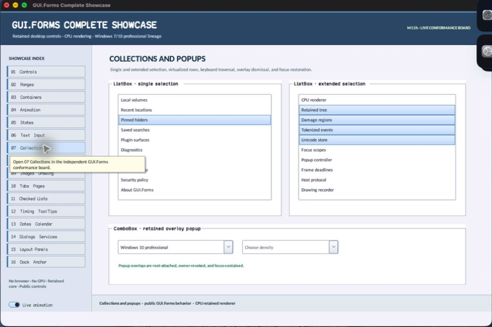

% Generated by tools/generate_library_docs.py from the checked-in headers and docs/library/manual.json. Do not edit by hand.

# ComboBox

- Status: **OBSERVED: bundle 004 split and drop-down-width enhancement; M4 build, focused tests, and Screen Sharing pass**
- Kind: **class / visual retained control**
- Scope: public header
- Source layout: isolated per type
- Hierarchy: `Panel → ComboBox`
- Declaration: `include/gui_forms/controls/panel/combo_box/combo_box.hpp:17`
- Definition: `src/controls/panel/combo_box/combo_box.cpp`
- Type narrative: hand-reviewed
- Method narratives: 26 hand-reviewed, 16 declaration-derived

ComboBox is a retained noneditable choice field with authoritative item selection, placeholder projection, keyboard cycling, a source-private transient ListBox, bounded item count, independent popup width, focus-safe lifetime handling, and option semantics.

## Visual evidence



M4 Complete Showcase collection crop showing retained field state and its bounded anchored ListBox popup.

## Declared methods

### `ComboBox` (public)

```cpp
explicit ComboBox(StableId stable_id)
```

Constructs a focusable choice field with handoff-ready transient popup ownership.

### `items` (public)

```cpp
[[nodiscard]] std::span<const std::string> items() const noexcept
```

Returns the authoritative ordered option strings.

### `set_items` (public)

```cpp
void set_items(std::vector<std::string> items)
```

Replaces options, repairs selection, synchronizes any open popup, and publishes coherent changes.

### `add_item` (public)

```cpp
void add_item(std::string item)
```

Appends one option, synchronizes the open popup, and invalidates retained state.

### `selected_index` (public)

```cpp
[[nodiscard]] std::optional<std::size_t> selected_index() const noexcept
```

Returns the selected option index or no value.

### `set_selected_index` (public)

```cpp
void set_selected_index(std::optional<std::size_t> index)
```

Validates the optional index, commits selection, synchronizes popup state, and publishes a real change.

### `selected_text` (public)

```cpp
[[nodiscard]] std::string_view selected_text() const noexcept
```

Returns selected option text or an empty view when nothing is selected.

### `placeholder_text` (public)

```cpp
[[nodiscard]] std::string_view placeholder_text() const noexcept
```

Returns the hint shown when no option is selected.

### `set_placeholder_text` (public)

```cpp
void set_placeholder_text(std::string text)
```

Commits placeholder text and invalidates field paint and semantics.

### `dropped_down` (public)

```cpp
[[nodiscard]] bool dropped_down() const noexcept
```

Reports whether this control currently owns its transient popup lease.

### `set_dropped_down` (public)

```cpp
void set_dropped_down(bool dropped_down)
```

Opens or closes through the common transient-owner state machine.

### `maximum_drop_down_items` (public)

```cpp
[[nodiscard]] std::size_t maximum_drop_down_items() const noexcept
```

Returns the positive cap on visible popup rows.

### `set_maximum_drop_down_items` (public)

```cpp
void set_maximum_drop_down_items(std::size_t count)
```

Accepts a bounded positive row count and rebuilds popup geometry when open.

### `drop_down_width` (public)

```cpp
[[nodiscard]] double drop_down_width() const noexcept
```

Returns zero for field-tracking width or an explicit logical popup width.

### `set_drop_down_width` (public)

```cpp
void set_drop_down_width(double width)
```

Accepts zero or a bounded finite width and repositions an open popup within client bounds.

### `font` (public)

```cpp
[[nodiscard]] FontSpec font() const noexcept
```

Returns the retained field and popup FontSpec.

### `set_font` (public)

```cpp
void set_font(FontSpec font)
```

Validates typography, synchronizes the popup, and invalidates size, paint, and semantics.

### `selected_index_changed` (public)

```cpp
[[nodiscard]] Event<std::optional<std::size_t>>& selected_index_changed() noexcept
```

Returns the event published after selected option commits.

### `drop_down_changed` (public)

```cpp
[[nodiscard]] Event<bool>& drop_down_changed() noexcept
```

Returns the event published after transient ownership opens or closes.

### `items_changed` (public)

```cpp
[[nodiscard]] Event<>& items_changed() noexcept
```

Returns the event published after option collection mutation.

### `on_paint` (public)

```cpp
void on_paint(Painter& painter, Rect local_damage) override
```

Records framed field, selected/placeholder text, focus cue, and disclosure arrow.

### `on_pointer` (public)

```cpp
void on_pointer(PointerEvent& event) override
```

Acquires focus and toggles popup ownership for a qualified primary click.

### `on_key` (public)

```cpp
void on_key(KeyEvent& event) override
```

Handles open/close, option cycling, commit, and cancellation keys.

### `on_focus_changed` (public)

```cpp
void on_focus_changed(bool focused) override
```

Updates focus painting while transient closure follows owner/revocation policy.

### `semantic_descriptor` (public)

```cpp
[[nodiscard]] SemanticDescriptor semantic_descriptor() const override
```

Projects a combo-box role, current option, expanded state, and selection actions.

### `on_semantic_action` (public)

```cpp
bool on_semantic_action(SemanticAction action, std::string_view value) override
```

Routes press/expand/collapse and set-value through ordinary selection and popup state.

### `on_detached_from_window` (protected)

```cpp
void on_detached_from_window() noexcept override
```

Executes ComboBox's on detached from window operation against retained state; the signature records its exact inputs, result, constness, and failure surface. *(declaration-derived)*

### `items_property_value` (private)

```cpp
[[nodiscard]] BindingValue items_property_value() const
```

Reports the current items property value value without mutation. *(declaration-derived)*

### `set_items_property` (private)

```cpp
void set_items_property(const BindingValue& value)
```

Synchronously updates the retained items property property. Validation, typed invalidation, and notifications are defined by the implementation. *(declaration-derived)*

### `reset_items_property` (private)

```cpp
void reset_items_property()
```

Returns items property to its inherited or default policy. *(declaration-derived)*

### `should_serialize_items_property` (private)

```cpp
[[nodiscard]] bool should_serialize_items_property() const noexcept
```

Reports the current should serialize items property value without mutation. *(declaration-derived)*

### `selected_index_property_value` (private)

```cpp
[[nodiscard]] BindingValue selected_index_property_value() const
```

Reports the current selected index property value value without mutation. *(declaration-derived)*

### `set_selected_index_property` (private)

```cpp
void set_selected_index_property(const BindingValue& value)
```

Synchronously updates the retained selected index property property. Validation, typed invalidation, and notifications are defined by the implementation. *(declaration-derived)*

### `text_property_value` (private)

```cpp
[[nodiscard]] BindingValue text_property_value() const
```

Reports the current text property value value without mutation. *(declaration-derived)*

### `set_text_property` (private)

```cpp
void set_text_property(const BindingValue& value)
```

Synchronously updates the retained text property property. Validation, typed invalidation, and notifications are defined by the implementation. *(declaration-derived)*

### `reset_text_property` (private)

```cpp
void reset_text_property()
```

Returns text property to its inherited or default policy. *(declaration-derived)*

### `should_serialize_text_property` (private)

```cpp
[[nodiscard]] bool should_serialize_text_property() const noexcept
```

Reports the current should serialize text property value without mutation. *(declaration-derived)*

### `popup_selection_changed` (private)

```cpp
void popup_selection_changed(const ListSelectionChange& change)
```

Executes ComboBox's popup selection changed operation against retained state; the signature records its exact inputs, result, constness, and failure surface. *(declaration-derived)*

### `open_drop_down` (private)

```cpp
void open_drop_down()
```

Executes ComboBox's open drop down operation against retained state; the signature records its exact inputs, result, constness, and failure surface. *(declaration-derived)*

### `close_drop_down` (private)

```cpp
void close_drop_down()
```

Executes ComboBox's close drop down operation against retained state; the signature records its exact inputs, result, constness, and failure surface. *(declaration-derived)*

### `commit_popup_selection` (private)

```cpp
void commit_popup_selection(std::size_t index)
```

Executes ComboBox's commit popup selection operation against retained state; the signature records its exact inputs, result, constness, and failure surface. *(declaration-derived)*

### `on_popup_revoked` (private)

```cpp
void on_popup_revoked()
```

Executes ComboBox's on popup revoked operation against retained state; the signature records its exact inputs, result, constness, and failure surface. *(declaration-derived)*
