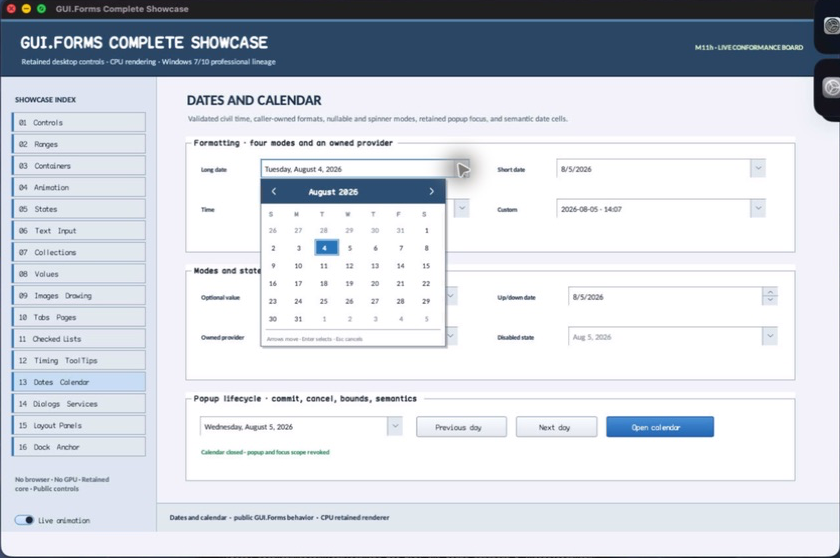

% Generated by tools/generate_library_docs.py from the checked-in headers and docs/library/manual.json. Do not edit by hand.

# DateTimeValue

- Status: **OBSERVED: bundle 004 value-type split and calendar arithmetic review; M4 build, focused tests, and Screen Sharing pass**
- Kind: **struct**
- Scope: public header
- Source layout: header-only or distributed
- Hierarchy: `DateTimeValue`
- Declaration: `include/gui_forms/controls/panel/date_time_picker/date_time_value/date_time_value.hpp:8`
- Definition: `inline/header-only`
- Type narrative: hand-reviewed
- Method narratives: 1 hand-reviewed, 1 declaration-derived

DateTimeValue is DateTimePicker's timezone-free civil date/time value. Ordering is lexicographic across validated year-through-second fields so range constraint and calendar selection remain deterministic.

## Visual evidence



M4 Complete Showcase crop showing the formatted field and selected popup day represented by DateTimeValue.

## Declared methods

### `operator==` (public)

```cpp
friend constexpr bool operator==(const DateTimeValue& left, const DateTimeValue& right) noexcept
```

Compares the complete value identity used by deterministic retained-state decisions. *(declaration-derived)*

### `operator<=>` (public)

```cpp
friend constexpr std::strong_ordering operator<=>( const DateTimeValue& left, const DateTimeValue& right) noexcept
```

Orders values chronologically by year, month, day, hour, minute, then second.
