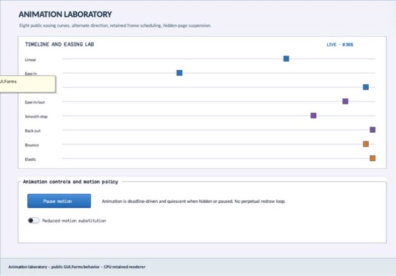

% Generated by tools/generate_library_docs.py from the checked-in headers and docs/library/manual.json. Do not edit by hand.

# EasingPreviewTrack

- Status: **OBSERVED: bundle 006 value-type split; M4 build, focused tests, and Screen Sharing pass**
- Kind: **struct**
- Scope: public header
- Source layout: header-only or distributed
- Hierarchy: `EasingPreviewTrack`
- Declaration: `include/gui_forms/controls/easing_preview/easing_preview.hpp:13`
- Definition: `inline/header-only`
- Type narrative: hand-reviewed
- Method narratives: 1 hand-reviewed, 0 declaration-derived

EasingPreviewTrack is one caller-authored easing comparison row: exact curve, label, and marker color.

## Visual evidence



M4 Complete Showcase crop showing eight configured curve/label/color track records.

## Declared methods

### `operator==` (public)

```cpp
friend bool operator==(const EasingPreviewTrack& left, const EasingPreviewTrack& right) noexcept(noexcept( left.curve == right.curve && left.label == right.label && left.color == right.color))
```

Compares curve, label, and color for exact retained configuration equality.
