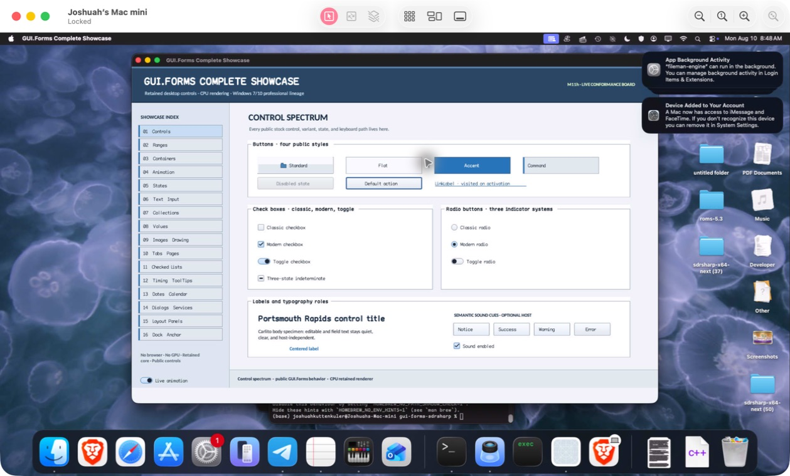

% Generated by tools/generate_library_docs.py from the checked-in headers and docs/library/manual.json. Do not edit by hand.

# FormControl

- Status: **OBSERVED: bundle 013 per-adapter source isolation; native and MinGW ABI builds pass**
- Kind: **class / visual retained control**
- Scope: source-private header
- Source layout: isolated per type
- Hierarchy: `Panel → FormControl`
- Declaration: `src/abi/control_adapters/form_control/form_control.hpp:11`
- Definition: `src/abi/control_adapters/form_control/form_control.cpp`
- Type narrative: hand-reviewed
- Method narratives: 4 hand-reviewed, 0 declaration-derived

FormControl is a retained Panel with a pre-focused-child key-preview bridge kept inside the compatibility adapter.

## Visual evidence



M4 native-window evidence exercises the compatibility form adapter inside the real AppKit host session.

## Declared methods

### `~FormControl` (public)

```cpp
~FormControl() override
```

Releases form-preview state through its isolated translation-unit boundary.

### `FormControl` (public)

```cpp
explicit FormControl(StableId stable_id) : Panel(std::move(stable_id))
```

Constructs the retained panel surface.

### `key_preview` (public)

```cpp
[[nodiscard]] gui_forms::Event<RasterKeySample&>& key_preview() noexcept
```

Returns mutable compatibility key-preview observation.

### `on_key_preview` (public)

```cpp
void on_key_preview(gui_forms::KeyEvent& event) override
```

Projects a core key event, emits preview, and copies handled state back.
