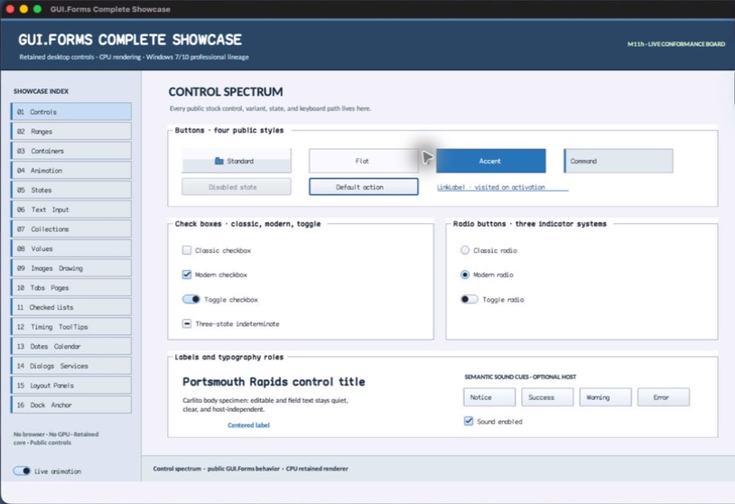

% Generated by tools/generate_library_docs.py from the checked-in headers and docs/library/manual.json. Do not edit by hand.

# HostSession

- Status: **OBSERVED: bundle 007 lifecycle state-machine split; M4 macOS/MinGW builds and focused tests pass**
- Kind: **class**
- Scope: public header
- Source layout: isolated per type
- Hierarchy: `HostSession`
- Declaration: `include/gui_forms/host/session/host_session.hpp:14`
- Definition: `src/core/host/session/host_session.cpp`
- Type narrative: hand-reviewed
- Method narratives: 9 hand-reviewed, 2 declaration-derived

HostSession is the foreign-boundary lifecycle machine between one native top-level presentation and one retained Window. It validates sequence, phase, geometry, typed drag payload, modal suppression, callback containment, close authorization, and terminal cleanup without admitting platform handles.

## Visual evidence



The captured AppKit window traversed constructed, attached, active, close-authorized, closed, and shutdown policy through this portable seam.

## Declared methods

### `HostSession` (public)

```cpp
HostSession(Window& window, HostCapabilities capabilities, HostServices* services = nullptr)
```

Binds one Window, capability set, optional service seam, UI thread, capture synchronization, and modal observation.

### `~HostSession` (public)

```cpp
~HostSession()
```

Idempotently shuts down and removes the Window service seam.

### `HostSession` (public)

```cpp
HostSession(const HostSession&) = delete
```

Binds one Window, capability set, optional service seam, UI thread, capture synchronization, and modal observation.

### `operator=` (public)

```cpp
HostSession& operator=(const HostSession&) = delete
```

Is deleted because one event sequence and lifecycle phase belong to one native attachment.

### `dispatch` (public)

```cpp
[[nodiscard]] HostDispatchResult dispatch(HostEvent event)
```

Validates thread/sequence/phase/geometry/payload, suppresses modal input, translates the event into retained operations, contains callback faults at the foreign boundary, publishes observation, and returns exact outcome.

### `shutdown` (public)

```cpp
void shutdown() noexcept
```

Idempotently revokes dispatcher, frame, pointer, drag, service attachment, and active/occluded state before committing terminal phase.

### `closing` (public)

```cpp
[[nodiscard]] Event<HostCloseRequest&>& closing() noexcept
```

Returns the cancelable close-request event evaluated before close authorization.

### `observed` (public)

```cpp
[[nodiscard]] Event<const HostEvent&, const HostDispatchResult&>& observed() noexcept
```

Returns the post-dispatch event carrying the original host event and exact portable result.

### `snapshot` (public)

```cpp
[[nodiscard]] HostSessionSnapshot snapshot() const
```

Returns capability, phase, sequence, acceptance, fault, close, display, modal, drag, attachment, activation, occlusion, and terminal telemetry.

### `observe_pointer_capture` (private)

```cpp
void observe_pointer_capture(const PointerCaptureChange& change)
```

Executes HostSession's observe pointer capture operation against retained state; the signature records its exact inputs, result, constness, and failure surface. *(declaration-derived)*

### `observe_modal_transition` (private)

```cpp
void observe_modal_transition(const HostModalTransition& transition)
```

Executes HostSession's observe modal transition operation against retained state; the signature records its exact inputs, result, constness, and failure surface. *(declaration-derived)*
