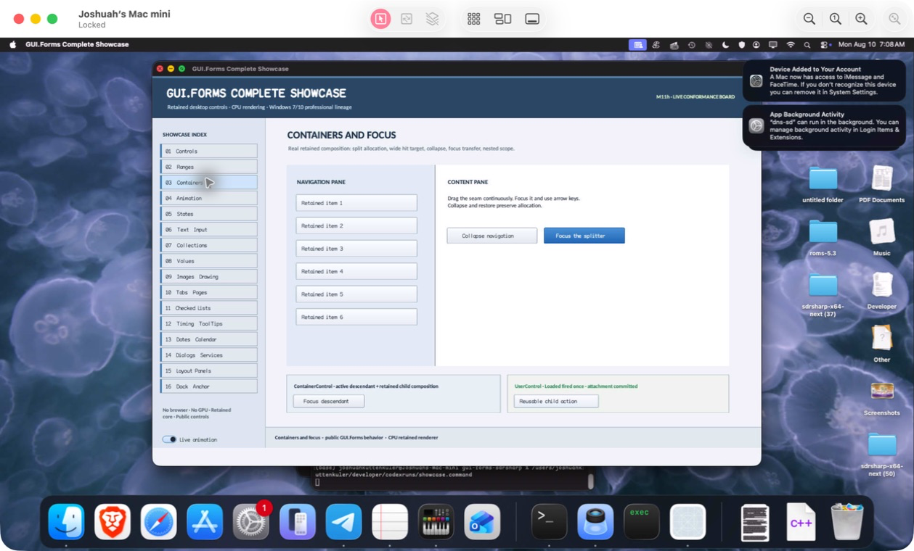

% Generated by tools/generate_library_docs.py from the checked-in headers and docs/library/manual.json. Do not edit by hand.

# InputTransparentControl

- Status: **OBSERVED: bundle 013 per-adapter source isolation; native and MinGW ABI builds pass**
- Kind: **class / visual retained control**
- Scope: source-private header
- Source layout: isolated per type
- Hierarchy: `Control → InputTransparentControl`
- Declaration: `src/abi/control_adapters/input_transparent_control/input_transparent_control.hpp:11`
- Definition: `src/abi/control_adapters/input_transparent_control/input_transparent_control.cpp`
- Type narrative: hand-reviewed
- Method narratives: 3 hand-reviewed, 0 declaration-derived

InputTransparentControl participates in retained layout/paint ordering while deliberately declining hit testing for compatibility placeholder surfaces.

## Visual evidence



M4 retained-container evidence includes structural compatibility surfaces that preserve layout and paint ordering while allowing input to pass through.

## Declared methods

### `~InputTransparentControl` (public)

```cpp
~InputTransparentControl() override
```

Releases the compatibility placeholder through its isolated translation-unit boundary.

### `InputTransparentControl` (public)

```cpp
explicit InputTransparentControl(StableId stable_id) : Control(std::move(stable_id))
```

Forwards stable identity to the retained Control base.

### `hit_test_local` (public)

```cpp
[[nodiscard]] bool hit_test_local(gui_forms::Point) const override
```

Always returns false so the placeholder cannot intercept input.
