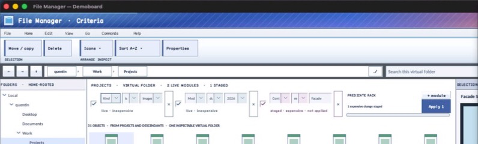

% Generated by tools/generate_library_docs.py from the checked-in headers and docs/library/manual.json. Do not edit by hand.

# InstrumentFieldSpec

- Status: **OBSERVED: bundle 006 instrument value split; M4 build, focused tests, and Screen Sharing pass**
- Kind: **struct**
- Scope: public header
- Source layout: header-only or distributed
- Hierarchy: `InstrumentFieldSpec`
- Declaration: `include/gui_forms/instrument/instrument_types.hpp:19`
- Definition: `inline/header-only`
- Type narrative: hand-reviewed
- Method narratives: no declared methods

InstrumentFieldSpec is caller-owned field identity, label, current value, editor family, choices, validation, proportional width, and required-state configuration.

## Visual evidence

M4 File Manager Demoboard crop showing choice/text field specs realized inside live criteria modules.

## Declared methods

No methods were discovered in this declaration.
