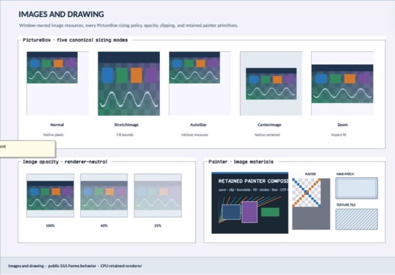

% Generated by tools/generate_library_docs.py from the checked-in headers and docs/library/manual.json. Do not edit by hand.

# MaterialFillLayer

- Status: **OBSERVED: bundle 012 isolated material-fill declaration/definition; native and MinGW M4 builds pass**
- Kind: **struct**
- Scope: public header
- Source layout: isolated per type
- Hierarchy: `MaterialFillLayer`
- Declaration: `include/gui_forms/surface_material/material_fill_layer/material_fill_layer.hpp:26`
- Definition: `src/core/surface_material/material_fill_layer/material_fill_layer.cpp`
- Type narrative: hand-reviewed
- Method narratives: 11 hand-reviewed, 2 declaration-derived

MaterialFillLayer is one renderer-neutral solid, gradient, or image recipe with explicit coordinate space, spread/wrap, source geometry, scale, and opacity.

## Visual evidence



M4 material demoboard showing solid, gradient, repeated, image, border, radius, and shadow realization.

## Declared methods

### `solid` (public)

```cpp
[[nodiscard]] static MaterialFillLayer solid(Color color)
```

Creates one solid-color layer.

### `linear` (public)

```cpp
[[nodiscard]] static MaterialFillLayer linear( Point start, Point end, std::vector<GradientStop> stops, MaterialCoordinateSpace space = MaterialCoordinateSpace::normalized, GradientSpreadMode spread = GradientSpreadMode::pad)
```

Creates a linear gradient with owned stops, coordinate space, and spread.

### `linear_css_angle` (public)

```cpp
[[nodiscard]] static MaterialFillLayer linear_css_angle( double angle_degrees, std::vector<GradientStop> stops, GradientSpreadMode spread = GradientSpreadMode::pad)
```

Executes MaterialFillLayer's linear css angle operation against retained state; the signature records its exact inputs, result, constness, and failure surface. *(declaration-derived)*

### `linear_css_angle` (public)

```cpp
[[nodiscard]] static MaterialFillLayer linear_css_angle( double angle_degrees, const GradientStop* stops, std::size_t stop_count, GradientSpreadMode spread = GradientSpreadMode::pad)
```

Executes MaterialFillLayer's linear css angle operation against retained state; the signature records its exact inputs, result, constness, and failure surface. *(declaration-derived)*

### `linear` (public)

```cpp
[[nodiscard]] static MaterialFillLayer linear( Point start, Point end, const GradientStop* stops, std::size_t stop_count, MaterialCoordinateSpace space = MaterialCoordinateSpace::normalized, GradientSpreadMode spread = GradientSpreadMode::pad)
```

Creates a linear gradient with owned stops, coordinate space, and spread.

### `repeating_linear` (public)

```cpp
[[nodiscard]] static MaterialFillLayer repeating_linear( Point start, Point end, std::vector<GradientStop> stops, MaterialCoordinateSpace space = MaterialCoordinateSpace::logical)
```

Creates a logical-coordinate repeating linear gradient.

### `repeating_linear` (public)

```cpp
[[nodiscard]] static MaterialFillLayer repeating_linear( Point start, Point end, const GradientStop* stops, std::size_t stop_count, MaterialCoordinateSpace space = MaterialCoordinateSpace::logical)
```

Creates a logical-coordinate repeating linear gradient.

### `radial` (public)

```cpp
[[nodiscard]] static MaterialFillLayer radial( Point center, Size radii, std::vector<GradientStop> stops, MaterialCoordinateSpace space = MaterialCoordinateSpace::normalized)
```

Creates a radial gradient with owned stops and explicit center/radii space.

### `radial` (public)

```cpp
[[nodiscard]] static MaterialFillLayer radial( Point center, Size radii, const GradientStop* stops, std::size_t stop_count, MaterialCoordinateSpace space = MaterialCoordinateSpace::normalized)
```

Creates a radial gradient with owned stops and explicit center/radii space.

### `stretched_image` (public)

```cpp
[[nodiscard]] static MaterialFillLayer stretched_image( ImageId image, Size pixel_size, double opacity = 1.0)
```

Creates a stretched image layer with source pixel size and bounded opacity.

### `tiled_image` (public)

```cpp
[[nodiscard]] static MaterialFillLayer tiled_image( ImageId image, Size pixel_size, double source_pixels_per_logical_pixel = 1.0, double opacity = 1.0)
```

Creates a tiled image layer with explicit source-pixel scale.

### `nine_patch` (public)

```cpp
[[nodiscard]] static MaterialFillLayer nine_patch( ImageId image, Size pixel_size, Insets source_slice, double source_pixels_per_logical_pixel = 1.0, double opacity = 1.0)
```

Creates a nine-slice image layer with source insets and scale.

### `operator==` (public)

```cpp
friend bool operator==(const MaterialFillLayer& left, const MaterialFillLayer& right) noexcept(noexcept( left.kind == right.kind && left.coordinate_space == right.coordinate_space && left.linear_geometry == right.linear_geometry && left.angle_degrees == right.angle_degrees && left.color == right.color && left.start == right.start && left.end == right.end && left.center == right.center && left.radii == right.radii && left.stops == right.stops && left.spread == right.spread && left.image == right.image && left.image_pixel_size == right.image_pixel_size && left.image_slice == right.image_slice && left.image_scale == right.image_scale && left.opacity == right.opacity && left.image_mode == right.image_mode))
```

Compares the complete authored fill recipe.
