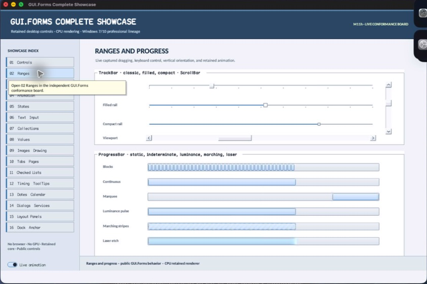

% Generated by tools/generate_library_docs.py from the checked-in headers and docs/library/manual.json. Do not edit by hand.

# ProgressBarAnimationAppearance

- Status: **OBSERVED: bundle 004 animation-value review; M4 build, focused tests, and Screen Sharing pass**
- Kind: **struct**
- Scope: public header
- Source layout: header-only or distributed
- Hierarchy: `ProgressBarAnimationAppearance`
- Declaration: `include/gui_forms/controls/range_control/progress_bar/progress_bar.hpp:27`
- Definition: `inline/header-only`
- Type narrative: hand-reviewed
- Method narratives: 1 hand-reviewed, 0 declaration-derived

ProgressBarAnimationAppearance is the validated value object for stripe width, gap, angle, and opacity used by painter-neutral progress animation.

## Visual evidence



M4 Complete Showcase crop showing determinate and animated ProgressBar styles whose stripe geometry and alpha are carried by this value.

## Declared methods

### `operator==` (public)

```cpp
friend constexpr bool operator==( const ProgressBarAnimationAppearance& left, const ProgressBarAnimationAppearance& right) noexcept
```

Compares every animation appearance field exactly.
