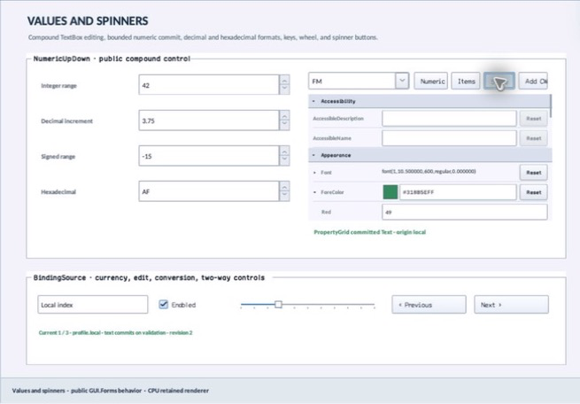

% Generated by tools/generate_library_docs.py from the checked-in headers and docs/library/manual.json. Do not edit by hand.

# PropertyConversionContext

- Status: **OBSERVED: bundle 006 conversion-policy split; M4 build and focused tests pass**
- Kind: **struct**
- Scope: public header
- Source layout: header-only or distributed
- Hierarchy: `PropertyConversionContext`
- Declaration: `include/gui_forms/inspection/property_value_converter_registry/property_value_converter_registry.hpp:14`
- Definition: `inline/header-only`
- Type narrative: hand-reviewed
- Method narratives: 1 hand-reviewed, 0 declaration-derived

PropertyConversionContext is an inspector-local culture label, decimal/group separator policy, and grouping flag. It never mutates process locale, so two grids can format independently and deterministic tests remain stable.

## Visual evidence



M4 Complete Showcase crop showing PropertyGrid formatting through an instance-owned conversion context.

## Declared methods

### `operator==` (public)

```cpp
friend bool operator==(const PropertyConversionContext& left, const PropertyConversionContext& right) noexcept( noexcept(left.culture_name == right.culture_name && left.decimal_separator == right.decimal_separator && left.group_separator == right.group_separator && left.use_grouping == right.use_grouping))
```

Compares culture name, separators, and grouping policy exactly.
