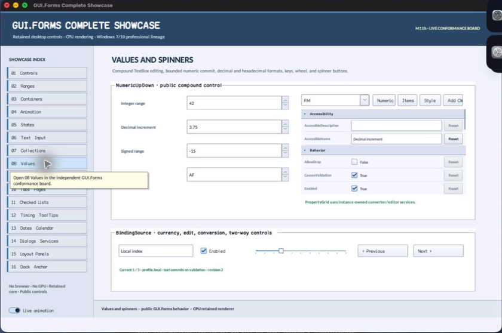

% Generated by tools/generate_library_docs.py from the checked-in headers and docs/library/manual.json. Do not edit by hand.

# SpinButtons

- Status: **OBSERVED: bundle 004 source-private state-machine split; M4 build, focused tests, and Screen Sharing pass**
- Kind: **class / visual retained control**
- Scope: source-private header
- Source layout: isolated per type
- Hierarchy: `Control → SpinButtons`
- Declaration: `src/controls/panel/numeric_up_down/spin_buttons.hpp:7`
- Definition: `src/controls/panel/numeric_up_down/spin_buttons.cpp`
- Type narrative: hand-reviewed
- Method narratives: 4 hand-reviewed, 0 declaration-derived

SpinButtons is NumericUpDown's source-private two-part command surface. It qualifies pointer capture independently for increment and decrement and publishes only directional intent.

## Visual evidence



M4 Complete Showcase crop showing the NumericUpDown trailing up/down button column painted and hit-tested by SpinButtons.

## Declared methods

### `SpinButtons` (public)

```cpp
explicit SpinButtons(StableId stable_id)
```

Constructs a non-tab-stop vertical two-command surface.

### `stepped` (public)

```cpp
[[nodiscard]] Event<int>& stepped() noexcept
```

Returns the event carrying +1 or -1 after a qualified release.

### `on_paint` (public)

```cpp
void on_paint(Painter& painter, Rect local_damage) override
```

Records framed upper/lower button states and directional chevrons.

### `on_pointer` (public)

```cpp
void on_pointer(PointerEvent& event) override
```

Tracks hover, press, capture, cancellation, and same-part release before publishing a step.
