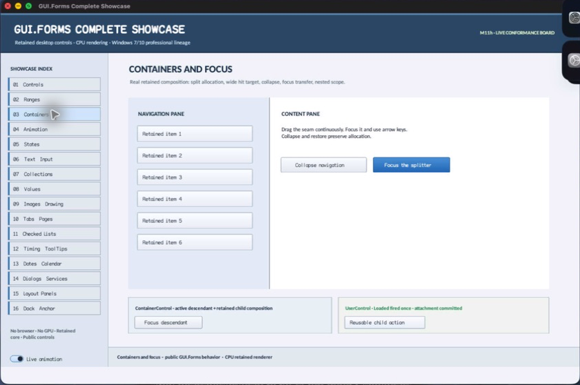

% Generated by tools/generate_library_docs.py from the checked-in headers and docs/library/manual.json. Do not edit by hand.

# SplitterGrip

- Status: **OBSERVED: bundle 003 source-private state-machine split; M4 build, focused tests, and Screen Sharing pass**
- Kind: **class / visual retained control**
- Scope: source-private header
- Source layout: isolated per type
- Hierarchy: `Control → SplitterGrip`
- Declaration: `src/controls/scrollable_control/container_control/split_container/splitter_grip.hpp:14`
- Definition: `src/controls/scrollable_control/container_control/split_container/splitter_grip.cpp`
- Type narrative: hand-reviewed
- Method narratives: 5 hand-reviewed, 23 declaration-derived

SplitterGrip is SplitContainer's source-private retained seam control. It owns only visual/focus/cursor/collapse-tab state while SplitContainer remains the allocation and input-policy authority.

## Visual evidence



M4 Complete Showcase crop showing the narrow visible SplitterGrip seam between panes; its wider pointer bounds and focus cue are owned separately from its painted thickness.

## Declared methods

### `SplitterGrip` (public)

```cpp
explicit SplitterGrip(StableId stable_id)
```

Constructs a focusable retained seam control with orientation-specific resize cursor policy.

### `set_orientation` (public)

```cpp
void set_orientation(Orientation orientation)
```

Validates orientation, updates the resize cursor, and invalidates painting.

### `set_visible_geometry` (public)

```cpp
void set_visible_geometry(double origin, double width)
```

Synchronously updates the retained visible geometry property. Validation, typed invalidation, and notifications are defined by the implementation. *(declaration-derived)*

### `set_collapse_appearance` (public)

```cpp
void set_collapse_appearance(SplitFixedPanel panel, bool collapsed)
```

Commits optional first/second collapse-tab direction and current collapsed appearance.

### `set_dragging` (public)

```cpp
void set_dragging(bool dragging)
```

Synchronously updates the retained dragging property. Validation, typed invalidation, and notifications are defined by the implementation. *(declaration-derived)*

### `set_actuator_pressed` (public)

```cpp
void set_actuator_pressed(bool pressed)
```

Synchronously updates the retained actuator pressed property. Validation, typed invalidation, and notifications are defined by the implementation. *(declaration-derived)*

### `set_transition_duration` (public)

```cpp
void set_transition_duration(FrameInterval duration)
```

Synchronously updates the retained transition duration property. Validation, typed invalidation, and notifications are defined by the implementation. *(declaration-derived)*

### `transition_duration` (public)

```cpp
[[nodiscard]] FrameInterval transition_duration() const noexcept
```

Reports the current transition duration value without mutation. *(declaration-derived)*

### `transition_active` (public)

```cpp
[[nodiscard]] bool transition_active() const noexcept
```

Reports the current transition active value without mutation. *(declaration-derived)*

### `transition_progress` (public)

```cpp
[[nodiscard]] double transition_progress() const noexcept
```

Reports the current transition progress value without mutation. *(declaration-derived)*

### `reset_interaction` (public)

```cpp
void reset_interaction() noexcept
```

Returns interaction to its inherited or default policy. *(declaration-derived)*

### `seam_state` (public)

```cpp
[[nodiscard]] SplitSeamState seam_state() const noexcept
```

Reports the current seam state value without mutation. *(declaration-derived)*

### `actuator_bounds` (public)

```cpp
[[nodiscard]] Rect actuator_bounds() const noexcept
```

Reports the current actuator bounds value without mutation. *(declaration-derived)*

### `visual_outsets` (public)

```cpp
[[nodiscard]] Insets visual_outsets() const noexcept override
```

Reports the current visual outsets value without mutation. *(declaration-derived)*

### `on_pointer` (public)

```cpp
void on_pointer(PointerEvent& event) override
```

Consumes normalized routed pointer input and updates retained interaction state. *(declaration-derived)*

### `on_focus_changed` (public)

```cpp
void on_focus_changed(bool focused) override
```

Stores the keyboard-focus cue and invalidates seam painting.

### `on_focus_cue_changed` (public)

```cpp
void on_focus_cue_changed(bool visible) override
```

Executes SplitterGrip's on focus cue changed operation against retained state; the signature records its exact inputs, result, constness, and failure surface. *(declaration-derived)*

### `on_paint` (public)

```cpp
void on_paint(Painter& painter, Rect local_damage) override
```

Records the centered visible seam, focused cue, and optional directional collapse tab within the enlarged control bounds.

### `on_frame` (public)

```cpp
void on_frame(FrameTime now) override
```

Executes SplitterGrip's on frame operation against retained state; the signature records its exact inputs, result, constness, and failure surface. *(declaration-derived)*

### `on_attached_to_window` (protected)

```cpp
void on_attached_to_window() override
```

Executes SplitterGrip's on attached to window operation against retained state; the signature records its exact inputs, result, constness, and failure surface. *(declaration-derived)*

### `on_detached_from_window` (protected)

```cpp
void on_detached_from_window() noexcept override
```

Executes SplitterGrip's on detached from window operation against retained state; the signature records its exact inputs, result, constness, and failure surface. *(declaration-derived)*

### `engaged` (private)

```cpp
[[nodiscard]] bool engaged() const noexcept
```

Reports the current engaged value without mutation. *(declaration-derived)*

### `actuator_bounds` (private)

```cpp
[[nodiscard]] Rect actuator_bounds(double cross_extent, double axis_extent) const noexcept
```

Reports the current actuator bounds value without mutation. *(declaration-derived)*

### `point_in_proximity` (private)

```cpp
[[nodiscard]] bool point_in_proximity(Point window_point) const noexcept
```

Reports the current point in proximity value without mutation. *(declaration-derived)*

### `target_actuator_size` (private)

```cpp
[[nodiscard]] Size target_actuator_size() const noexcept
```

Reports the current target actuator size value without mutation. *(declaration-derived)*

### `retarget_transition` (private)

```cpp
void retarget_transition()
```

Executes SplitterGrip's retarget transition operation against retained state; the signature records its exact inputs, result, constness, and failure surface. *(declaration-derived)*

### `update_transition_registration` (private)

```cpp
void update_transition_registration()
```

Executes SplitterGrip's update transition registration operation against retained state; the signature records its exact inputs, result, constness, and failure surface. *(declaration-derived)*

### `complete_transition` (private)

```cpp
void complete_transition() noexcept
```

Executes SplitterGrip's complete transition operation against retained state; the signature records its exact inputs, result, constness, and failure surface. *(declaration-derived)*
