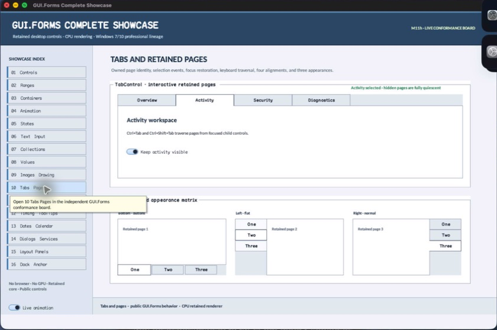

% Generated by tools/generate_library_docs.py from the checked-in headers and docs/library/manual.json. Do not edit by hand.

# TabPage

- Status: **OBSERVED: bundle 003 split; M4 build, focused tests, and Screen Sharing pass**
- Kind: **class / visual retained control**
- Scope: public header
- Source layout: isolated per type
- Hierarchy: `Panel → TabPage`
- Declaration: `include/gui_forms/controls/scrollable_control/container_control/tab_control/tab_page/tab_page.hpp:9`
- Definition: `src/controls/scrollable_control/container_control/tab_control/tab_page/tab_page.cpp`
- Type narrative: hand-reviewed
- Method narratives: 4 hand-reviewed, 0 declaration-derived

TabPage is an owned Panel surface with bounded caption text and page semantics; TabControl, not the page, owns selection and header interaction.

## Visual evidence



M4 Complete Showcase crop showing retained TabPage content surfaces; inactive pages remain owned but are excluded from the active visual/semantic tree.

## Declared methods

### `TabPage` (public)

```cpp
explicit TabPage(StableId stable_id, std::string text =
```

Constructs a Panel page with authored caption text.

### `text` (public)

```cpp
[[nodiscard]] const std::string& text() const noexcept
```

Returns the tab header caption owned by this page.

### `set_text` (public)

```cpp
void set_text(std::string text)
```

Validates bounded UTF-8 caption text and invalidates parent measurement, painting, and semantics.

### `semantic_descriptor` (public)

```cpp
[[nodiscard]] SemanticDescriptor semantic_descriptor() const override
```

Projects the selected content surface as a named page group while its TabControl owns the virtual tab action.
