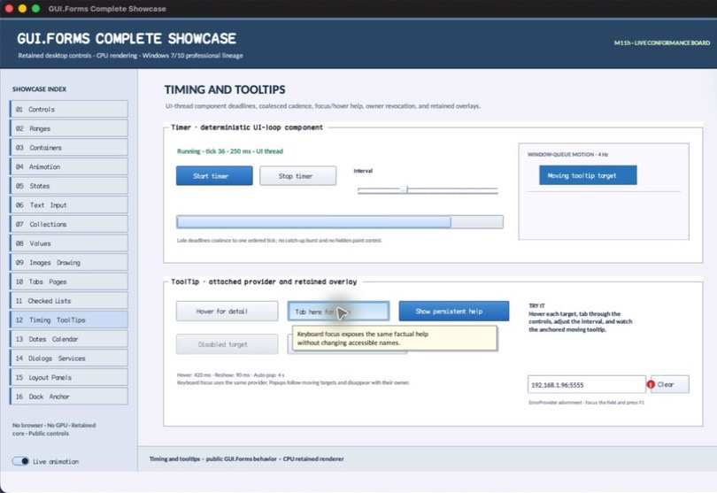

% Generated by tools/generate_library_docs.py from the checked-in headers and docs/library/manual.json. Do not edit by hand.

# ToolTipEvent

- Status: **OBSERVED: bundle 005 provider event split; M4 build, focused tests, and Screen Sharing pass**
- Kind: **struct**
- Scope: public header
- Source layout: header-only or distributed
- Hierarchy: `ToolTipEvent`
- Declaration: `include/gui_forms/components/tool_tip/tool_tip.hpp:21`
- Definition: `inline/header-only`
- Type narrative: hand-reviewed
- Method narratives: no declared methods

ToolTipEvent is the immutable publication payload for a tooltip visibility transition. It names the stable target, carries the presented text, and records shown/hidden and keyboard/pointer origin without exposing overlay internals.

## Visual evidence

M4 Complete Showcase crop showing the visible keyboard-initiated tooltip represented by target identity, text, visibility, and input-origin fields.

## Declared methods

No methods were discovered in this declaration.
